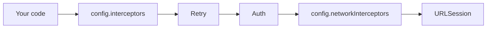

# EnziNet

A small, modern networking library for Apple platforms, built on `URLSession` and Swift concurrency (`async/await`). Zero dependencies.

- Typed requests with `Codable` bodies and responses
- **Interceptors**: a composable chain for custom behaviour
- **Authentication**: bearer tokens, Keychain storage, automatic refresh on 401 (single-flight)
- **Retry**: exponential backoff + jitter, `Retry-After`, idempotent-only by default
- **Downloads & uploads** with progress and cancellation (multipart supported)
- Protocol-based (`NetworkClient`), so it is trivial to mock in your app's tests

Requires iOS 15+, macOS 12+, tvOS 15+, watchOS 8+ and Swift 5.9+.

## Installation

Xcode: **File ▸ Add Package Dependencies…** and paste the repo URL.

`Package.swift`:

```swift
dependencies: [
    .package(url: "https://github.com/<you>/EnziNet.git", from: "0.1.0")
],
targets: [
    .target(name: "MyApp", dependencies: ["EnziNet"])
]
```

## Quick start

```swift
import EnziNet

struct User: Codable, Sendable { let id: Int; let name: String }

let client = EnziClient(baseURL: URL(string: "https://api.example.com/v1")!)

// GET + decode
let user: User = try await client.send(.get("/users/1"))

// POST JSON
struct NewUser: Encodable, Sendable { let name: String }
let created: User = try await client.send(.post("/users", body: .json(NewUser(name: "Ada"))))

// Query params, headers, per-request timeout
var request = Request.get("/search", query: ["q": "swift", "page": "2"])
request.headers["X-Trace"] = "abc"
request.timeout = 10
let response = try await client.send(request)   // raw Response (data, statusCode, headers)
```

Tip: wrap your endpoints so call sites stay clean.

```swift
enum UsersAPI {
    static func get(id: Int) -> Request { .get("/users/\(id)") }
    static func create(_ u: NewUser) -> Request { .post("/users", body: .json(u)) }
}
let user: User = try await client.send(UsersAPI.get(id: 1))
```

## Configuration

```swift
var config = EnziConfiguration(baseURL: URL(string: "https://api.example.com")!)
config.defaultHeaders["X-Client"] = "ios"
config.timeout = 30
config.decoder.keyDecodingStrategy = .convertFromSnakeCase
config.decoder.dateDecodingStrategy = .iso8601
config.retryPolicy = .default
config.authenticator = auth                       // see below
config.interceptors = [HeaderInterceptor(["User-Agent": "MyApp/1.0"])]
config.networkInterceptors = [LoggingInterceptor(level: .headers)]
let client = EnziClient(configuration: config)
```

## Authentication

```swift
let auth = BearerAuthenticator(
    store: KeychainTokenStore(service: "com.myapp.auth"),
    refresh: { current in
        // call your refresh endpoint using a client WITHOUT the authenticator
        let r: TokenResponse = try await plainClient.send(
            .post("/auth/refresh", body: .json(["refresh_token": current.refreshToken ?? ""]), requiresAuth: false))
        return AuthToken(accessToken: r.access, refreshToken: r.refresh, expiresAt: r.expiry)
    }
)
await auth.setToken(AuthToken(accessToken: "…", refreshToken: "…"))   // after login
await auth.signOut()                                                  // on logout
```

- Requests are `requiresAuth: true` by default; set `false` for login/refresh/public endpoints.
- On a **401** the authenticator refreshes and the call is retried **once**.
- If 10 requests hit a 401 at once, only **one** refresh call is made; the others reuse it.
- Need API keys? Use `HeaderAuthenticator(name:value:)`. Need something else (OAuth, HMAC signing)? Implement the `Authenticator` protocol (two methods).

## Retry

```swift
let policy = RetryPolicy(
    maxRetries: 4,
    backoff: .exponential(base: 0.5, multiplier: 2, maxDelay: 20, jitter: true),
    retryableStatusCodes: [429, 500, 502, 503, 504]
)
config.retryPolicy = policy            // client-wide
request.retryPolicy = .none            // or per request
```

Defaults: 3 retries, idempotent methods only (GET/HEAD/PUT/DELETE/OPTIONS), statuses 408/429/5xx, connection-type `URLError`s. A `Retry-After` header is honoured. `POST`/`PATCH` are **not** retried unless you add them to `retryableMethods`.

## Interceptors

```swift
struct TimingInterceptor: Interceptor {
    func intercept(_ request: URLRequest, context: RequestContext, next: Next) async throws -> HTTPResult {
        let start = Date()
        let result = try await next(request)          // call the rest of the chain
        print("\(request.url?.path ?? "") took \(Date().timeIntervalSince(start))s")
        return result
    }
}
```

An interceptor can edit the request, inspect or replace the result, call `next` multiple times, or not at all (e.g. a cache or a mock).



Use `interceptors` for things that care about the logical call, and `networkInterceptors` (e.g. logging) to see every attempt, including retries and token refreshes.

## Downloads & uploads

```swift
// Download with progress; cancel by cancelling the Task
let task = Task {
    try await client.download(.get("/files/report.pdf"), to: destinationURL) { p in
        print("\(Int(p.fraction * 100))%")
    }
}

// Upload a file (streamed from disk)
let resp = try await client.upload(.post("/avatar"), fromFile: fileURL) { print($0.fraction) }

// Multipart form
var form = MultipartFormData()
form.append("Holiday", name: "title")
try form.append(fileAt: photoURL, name: "photo")
_ = try await client.upload(.post("/photos"), multipart: form)
```

Progress callbacks are invoked on a background thread; hop to `@MainActor` before touching UI.

## Error handling

```swift
do {
    let user: User = try await client.send(.get("/users/1"))
} catch let EnziError.httpStatus(response) {
    print(response.statusCode, String(data: response.data, encoding: .utf8) ?? "")
} catch EnziError.transport(let urlError) {
    print("offline?", urlError.code)
} catch EnziError.cancelled {
    // task cancelled
} catch {
    // decoding errors, auth errors, your own interceptor errors…
}
```

## Testing your app

Depend on the protocol, not the class:

```swift
final class MockClient: NetworkClient { /* return canned Responses */ }
```

For integration-style tests, build a `URLSession` whose `protocolClasses` contains your own `URLProtocol` and pass it in `EnziConfiguration(session:)`. See `Tests/EnziTests/MockURLProtocol.swift`.

## Roadmap

- [ ] Resumable downloads and background `URLSession` support
- [ ] Response caching interceptor
- [ ] Request/response mocking helpers (`EnziTesting` product)
- [ ] Certificate pinning (`URLSessionDelegate` hook)
- [ ] Reachability-aware retry
- [ ] Download/upload going through the full interceptor chain
- [ ] DocC documentation site on GitHub Pages
- [ ] WebSocket / SSE support

## Contributing

Issues and PRs welcome. Run `swift test` before opening a PR.

## License

MIT, see [LICENSE](LICENSE).
